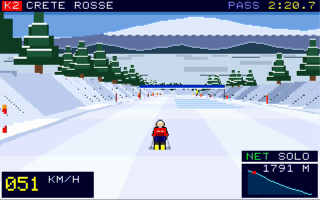
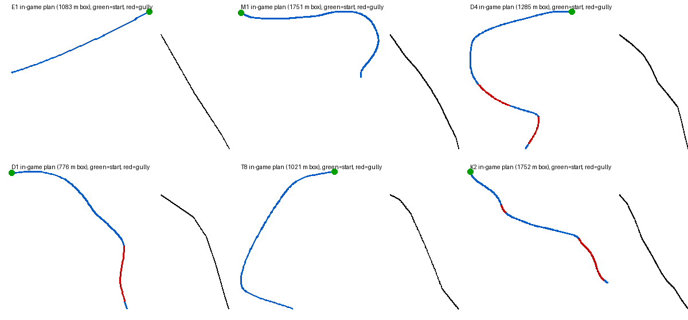

# Skipass Madness After Christmas

An original 320×200 PRG32 downhill skiing cartridge set in the Roccaraso / Alto Sangro ski area (Abruzzo, Italy). It runs on the ESP32-C6 console and in QEMU with the 128 KiB cartridge profile.



## The game

A drone-follow camera behind the skier shows the piste in 2.5D. It is not a road racer: the screen is built from the piste's real altitude profile. Crests hide the slope beyond them, steep pitches open up the valley below, and the camera pitches and yaws with the mountain.

The six pistes are traced from the official Alto Sangro panoramic piste map ([docs/pistes.md](docs/pistes.md)). Each keeps the map's sequence of turns, pitches, traverses and gullies, its real start and finish altitudes, the forest on either side and the lifts it passes under:

| Piste | Name | Altitudes | In game | What you ski |
|---|---|---|---|---|
| E1 | Aremogna | 1850 → 1668 m | 1.2 km, blue | Valle Verde to Piazzale Aremogna: the straight, wide boulevard |
| M1 | Monte Pratello | 2040 → 1745 m | 2.5 km, blue | the panoramic ridge east from Esagono, then the hook down to Prato |
| D4 | Toppe-Aremogna | 2141 → 1668 m | 2.4 km, red | summit ridge west, a hairpin, the banked C4-D4 forest track, the gap pitch to Aremogna |
| D1 | Toppe del Tesoro | 2141 → 1850 m | 1.2 km, black | summit ridge east, the drop to G2, then the narrow rock-walled chute to Valle Verde |
| T8 | Pizzalto | 1850 → 1484 m | 1.6 km, red | under the Pizzalto summit, the long diagonal face, round onto T2 |
| K2 | Crete Rosse | 1830 → 1309 m | 2.4 km, red | forest S-bends from the Crete Rosse hut to Monte Pratello hut, then the P1 valley to Rivisondoli |

Gully walls bank you back toward the bed and cost you speed as you climb them; go over the rim and you fall. Where the map shows open snowfields you can wander into deep powder; where it shows forest, the trees are waiting.



Along the way you meet rifugi, chairlifts with moving chairs, snow cannons, moguls, ice sheets, kickers, snowcats and the after-Christmas crowd: wandering tourists, ski-school lines and seated snowboarders. Reach the valley before your skipass expires. Each checkpoint adds 5 s.

The physics runs in fixed point (cm, cm/s, Q12 trigonometry) and models:

- gravity along the skis' heading;
- Coulomb snow friction for groomed snow, powder, ice, moguls, the snowplough, the hockey stop and skidding;
- v² aerodynamic drag, upright or tucked;
- a carving-radius limit on the turn rate;
- ballistic air from kickers and crests, with landing impacts.

The MAESTRO assist is on by default and toggled with B on the title screen. It steers round hazards while you aren't steering yourself, and it also drives the demo mode.

## Controls

| Input | Action |
|---|---|
| Left / Right | carve; the turn rate is limited by the carving radius at speed |
| Up | tuck: less drag, slower turns |
| Down | snowplough; across the slope, a hockey stop |
| B | pole push; on the title, toggle MAESTRO |
| A / Start | choose a piste and start; Start returns to the title |

## Graphics and audio

Sprites (13 rear-view skier poses × 3 levels of detail, generated by `scripts/gen_sprites.py`) are 4-bit indexed. The background is drawn with indexed rectangles from a custom palette (slots 8–15 and 232–255) plus the console colour cube.

Stereo SID-like tracker music plays only on the title/demo screen (a saltarello in 6/8), the winning screen (a fanfare) and the game-over screen (a lament). While you ski, the music stops and stereo procedural effects take over: snow hiss that follows speed and surface, gusting wind, a carving scrape, landings, crashes, near-miss whooshes and checkpoint chimes.

## Multiplayer

Consoles join the room `skipass-madness-roccaraso-v2` through the PRG32 multiplayer API. Rivals on the same piste appear as skiers on the slope and as dots on the altitude profile, with a live P*n*/*m* ranking. Offline play is complete without a network.

## Build

You need sibling checkouts of `riscv-prg32/PRG32` (or set `PRG32_REPO`) and an ESP-IDF environment for the RISC-V toolchain:

```sh
source $HOME/esp-idf/export.sh
./build.sh
```

This writes `dist/skipass-madness-esp32c6.prg32`, `dist/skipass-madness-qemu.prg32` and, once the media in `assets/` exist, the Cartridge Store bundle `dist/skipass-madness-2.1.0.zip`. It regenerates `pistes.h` from the traces in `scripts/trace_pistes.py`; set `SKIPASS_MAP` to the map image (extracted with `pdfimages -j` from the piste map PDF) to resample forest and lift crossings too.

## Tests and media

```sh
sh tests/check_source.sh
```

The script runs the source policy checks (including that `pistes.h` matches `scripts/trace_pistes.py`) and the host harness in `tests/host/`, which compiles `game.c` against a stub API. The harness runs the autopilot down every piste and a sanitizer fuzz, and can render frames (`host render`, `host title`) or dump the course plans (`host plan`).

Start a local [PRG32 Multiplayer Server](https://github.com/riscv-prg32/PRG32-Multiplayer-Server) on 127.0.0.1:8081 first. Then:

- `python3 scripts/multiplayer_test.py --out <dir>` runs two QEMU consoles in the same room and checks that each one sees the other.
- `python3 scripts/capture_media.py` records the 60-second QEMU preview (title, then K2 Crete Rosse into its forest gully). It writes `assets/preview.mp4` (H.264/AAC, as the Store requires), `assets/preview.mp3` (the same audio), the screenshot and the icon.

QEMU reaches the server through a slirp `guestfwd` to the firmware's compiled server address, because the firmware stalls while it reconnects to a server it can't reach. See [docs/architecture.md](docs/architecture.md).

## References

- PRG32: https://github.com/riscv-prg32/PRG32
- Roccaraso piste map: https://www.datocms-assets.com/57366/1660222120-roccaraso-piste.pdf

Piste names, codes, altitudes and shapes follow the public map, read through a fitted perspective model and shortened to 62% for play. The courses are not a navigation aid.
